<!-- Cards are rendered by render_cards.py and refreshed daily by .github/workflows/cards.yml -->

  

  
  
  

🎀 ✦ ･ﾟ: *✧･ﾟ:* 🌸 *:･ﾟ✧*:･ﾟ ✦ 🎀

  

  

  <a href="https://faunabehav-api.onrender.com/docs"><b>FaunaBehav live demo</b></a> · interactive API docs, login <code>admin</code> / <code>demo-password</code> (first load can take a minute)

📌 <b>more pinned projects</b>

<table>
  <tr>
    <td width="50%" valign="top">
      <h3>🎀 <a href="https://github.com/tasniamoumi/veil">veil</a></h3>
      <b>HTML</b>
      
Privacy-first AI application that detects and masks sensitive information before prompts reach cloud-based AI models.

    </td>
    <td width="50%" valign="top">
      <h3>🩷 <a href="https://github.com/tasniamoumi/leadops">leadops</a></h3>
      <b>TypeScript</b>
      
Durable lead ingestion and delivery between website forms and a CRM.

    </td>
  </tr>
  <tr>
    <td width="50%" valign="top">
      <h3>✨ <a href="https://github.com/tasniamoumi/handframe">handframe</a></h3>
      <b>JavaScript</b>
      
Make a live filter window with your hands, in the browser.

    </td>
    <td width="50%" valign="top"></td>
  </tr>
</table>

🎀 ✦ ･ﾟ: *✧･ﾟ:* 🌸 *:･ﾟ✧*:･ﾟ ✦ 🎀

  

🩷 thanks for stopping by ✨

