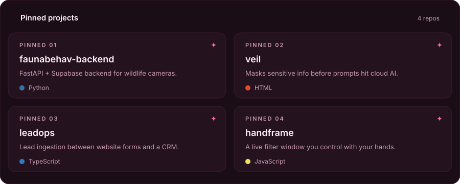

<!-- Cards are rendered by render_cards.py and refreshed daily by .github/workflows/cards.yml -->

  

  
  
  

🎀 ✦ ･ﾟ: *✧･ﾟ:* 🌸 *:･ﾟ✧*:･ﾟ ✦ 🎀

  

  

  <a href="https://faunabehav-api.onrender.com/docs"><b>FaunaBehav live demo</b></a> · interactive API docs, login <code>admin</code> / <code>demo-password</code> (first load can take a minute)

🎀 ✦ ･ﾟ: *✧･ﾟ:* 🌸 *:･ﾟ✧*:･ﾟ ✦ 🎀

  

🩷 thanks for stopping by ✨

